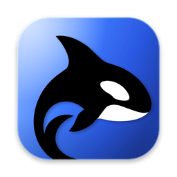

# Orca Find

Find any file on your Mac by asking for it.

[](LICENSE)
[](#requirements)
[](https://github.com/itsgrj/orca-find/releases/latest)
[](https://github.com/itsgrj/orca-find/releases)
[](https://github.com/itsgrj/orca-find/actions/workflows/build.yml)

[](https://github.com/itsgrj/orca-find/releases/latest)

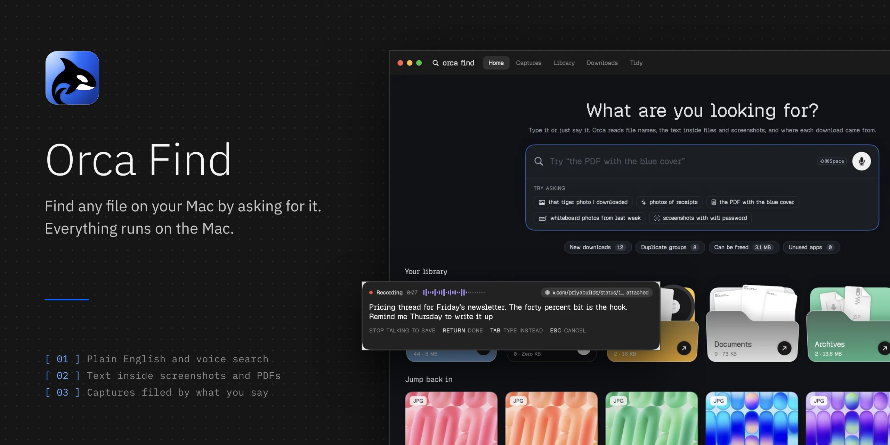

Orca Find is a native macOS file finder. Files show up as big thumbnail cards, and search understands plain English or your voice. It reads the text inside screenshots and PDFs, knows which website every download came from, and lets you grab anything on screen and say out loud why you saved it.

Everything runs on your Mac. Indexing, text recognition, duplicate detection, voice and the optional AI models never send your files anywhere.

## Get started

1. Download **Orca-Find.zip** from the [latest release](https://github.com/itsgrj/orca-find/releases/latest), unzip it and drag **Orca Find** into Applications.
2. Open it. The first time, macOS says it can't check the app, because it isn't notarized yet. Go to **System Settings › Privacy & Security** and click **Open Anyway**.
3. Allow Desktop, Documents and Downloads when asked. Orca only reads them on this Mac.
4. Type or say what you're looking for. Press **⇧⌘Space** from any app for Quick Search, and **⌥⇧Space** to grab something on screen.

## What it does

### [ 01 ] Ask for it

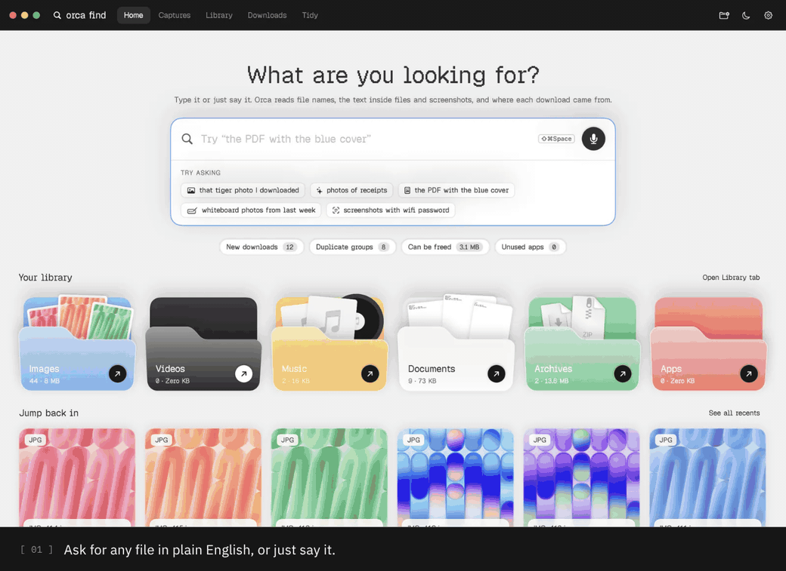

- **Plain English search.** "pdfs from last week over 5 mb", "the PDF with the blue cover" or "that tiger photo I downloaded". Orca shows how it understood you as chips you can remove.
- **Text inside files.** Vision reads text in screenshots and photos, PDFKit reads PDFs, and it all lands in a local SQLite full-text index. Copy the text straight from a preview.
- **Pictures by what's in them.** Apple Vision labels and main colours, plus Apple's MobileCLIP model when you unlock it, so "our holiday by the sea" finds IMG_4122.
- **Long sentences.** On macOS 26, Apple Intelligence reads chatty queries on the device. Short ones are handled instantly by Orca's own rules.
- **Voice search.** Press ⌥⌘F or click the mic.
- **Quick Search.** A floating panel on ⇧⌘Space, with a shortcut you can change.

### [ 02 ] Captures


- **Grab anything** on screen with ⌥⇧Space, then just say why you saved it. Stop talking and it's saved.
- **Filed from your words.** "for Friday's newsletter" picks the collection, "tag it pricing" adds tags and "remind me Thursday" creates an Apple Reminder that links back.
- **Keeps the context.** The page link from your browser, the text in the picture and your note stay with every capture.
- **Hears you properly.** After saving, Orca listens to the recording again, removes the "uh"s and files the capture by what you actually said.
- **Talk to it from Claude.** A built-in MCP server lets Claude search your captures. See [Connect Claude](#connect-claude).

### [ 03 ] Library and smart folders

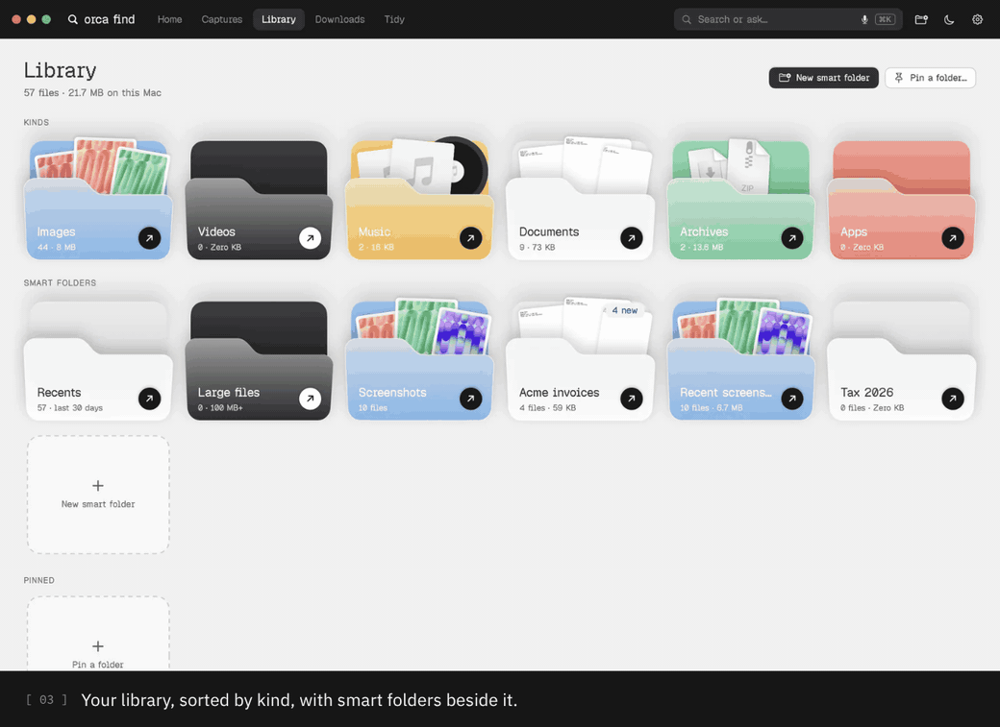

- **Library** sorted by kind, with a storage summary and pinned folders.
- **Smart folders** that you describe in words or build from rules: kind, name, text inside, looks like, colour, came from, date, size and folder. New files join the moment Orca sees them.
- **Saved searches** that stay live in the sidebar.

### [ 04 ] Tidy up

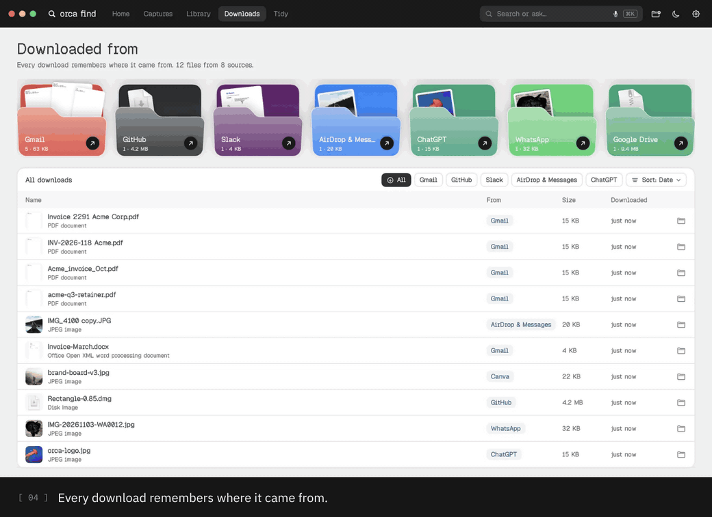

- **Downloaded from.** Every download remembers its source: Gmail, Google Drive, ChatGPT, Canva, Slack, WhatsApp, GitHub, AirDrop and any website.
- **Duplicates and look-alikes.** Exact copies by size, edge hash and SHA-256, plus similar photos and HEIC/JPEG pairs. Orca picks the copy to keep, and iCloud-only files are skipped.
- **Clean Up.** Six cards of things you can safely remove, with adjustable limits and Undo.
- **Automatic clean-up** (off by default): old installers to the Trash, screenshots into monthly folders, with an activity log.

### [ 05 ] Light and dark

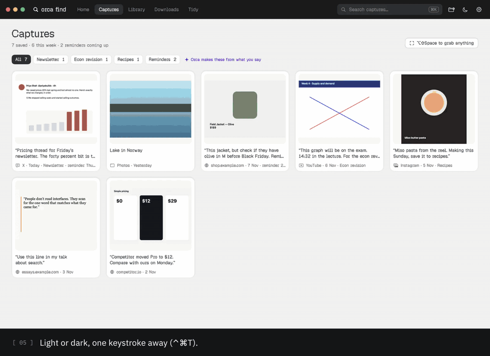

Switch with ⌃⌘T or the moon in the top bar.

### Edit right in the preview

Every preview gets a floating bar with the four most-used actions for that kind of file, and a sidebar with every tool (⌘T hides it). Edits always save a new copy next to the original, with Undo, Show in Finder and Replace original.

| File | Tools |
|---|---|
| Photos and screenshots | Remove background, crop, erase an object, draw, redact, adjust and looks, Live Text copy, translate, convert, resize, compress, strip location |
| PDFs | Copy text, highlight, reorder, rotate, split, combine, fill forms, sign, password, compress, make searchable, scan from iPhone |
| Video and audio | Trim, MP4, GIF, compress, crop, rotate, resize, save a frame, extract audio, transcribe, convert to M4A, WAV or AIFF |
| Anything else | Zip, share, rename, copy path |

### Orca's private AI

The heavier models are optional. You unlock each one once from inside the app, and it runs on your Mac from then on. Downloads are pinned to tested versions and checked by SHA-256.

| Skill | What it does | Model | Size |
|---|---|---|---|
| Understands your photos | Find photos by describing them | Apple MobileCLIP-S2 | 190 MB |
| Pro eraser | Best-quality object removal (a quick eraser is built in) | LaMa | 200 MB |
| Hears you clearly | Voice notes and search that get names and numbers right | NVIDIA Parakeet TDT 0.6B v2 | 460 MB |

## Screenshots

| | |
|---|---|
| 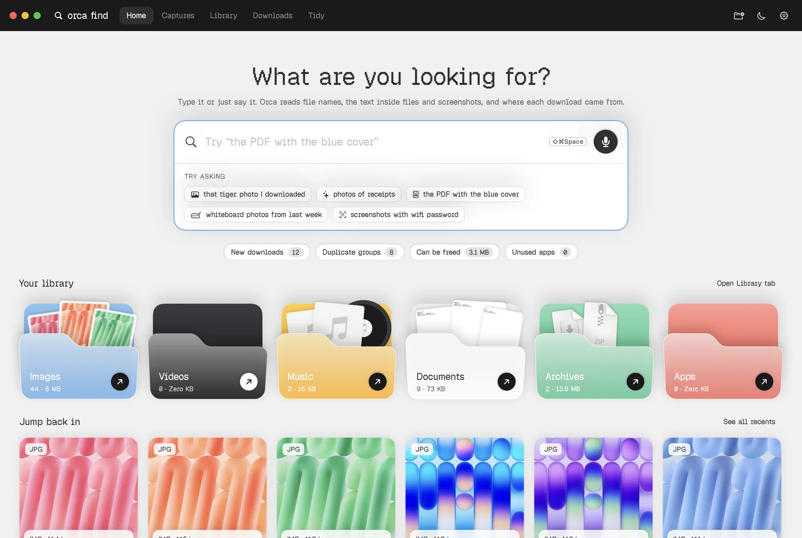 | 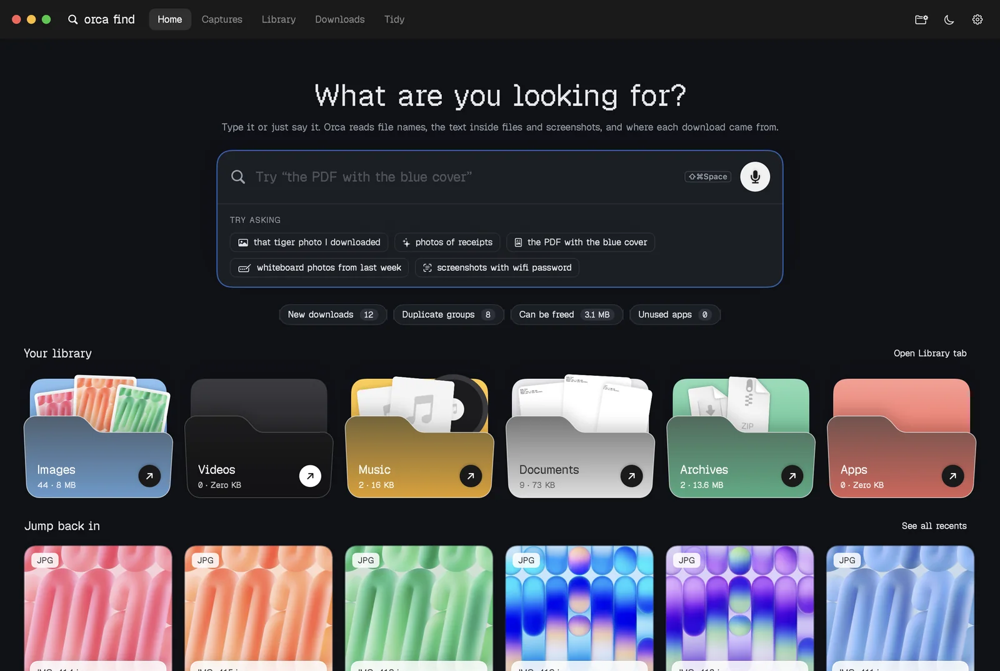 |
| **Home.** Ask, or pick up where you left off. | **Dark mode.** Same window, after dark. |
| 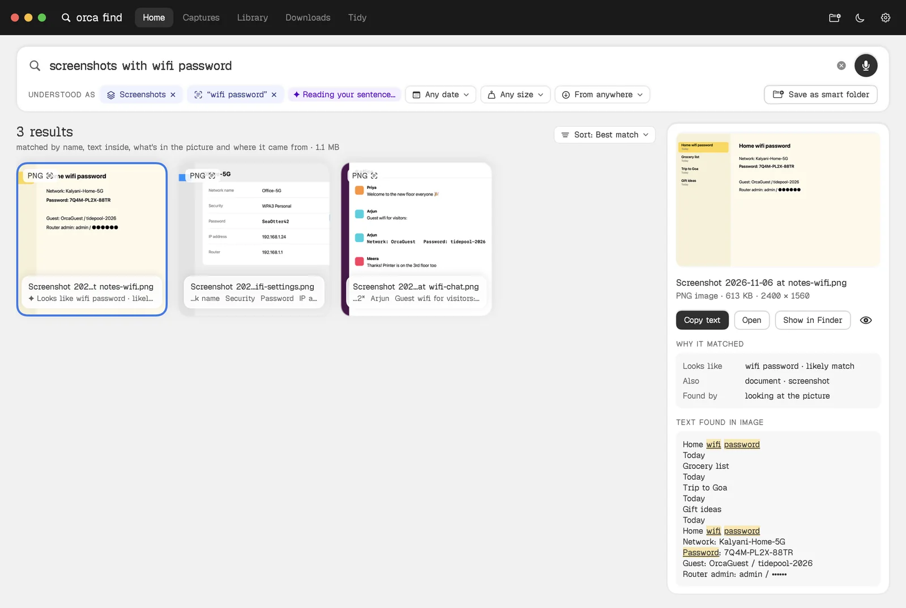 | 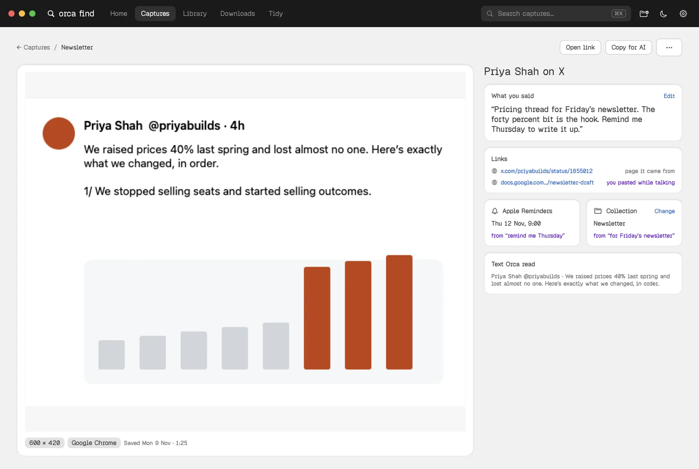 |
| **Results.** Each file says why it matched. | **A capture.** Your note, the link, the reminder. |
| 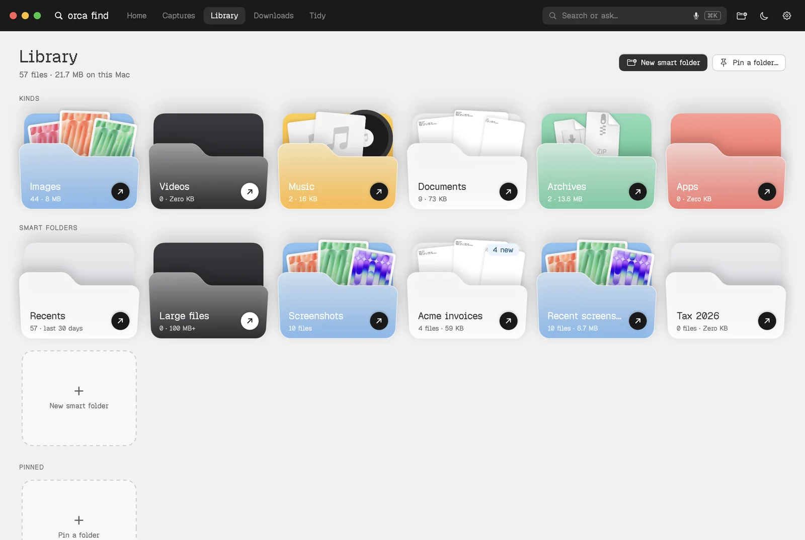 | 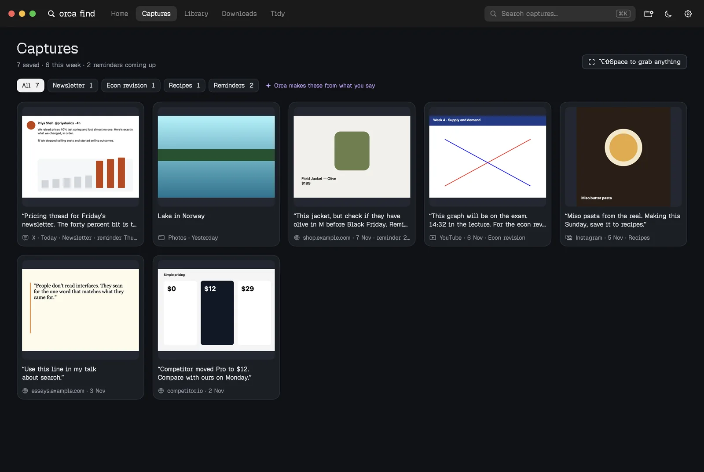 |
| **Library.** Kinds, smart folders, pinned folders. | **Captures.** Filed by collection and tag. |
| 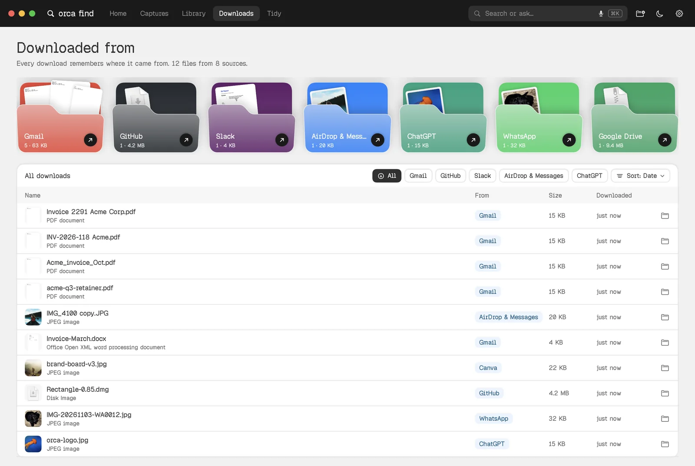 | 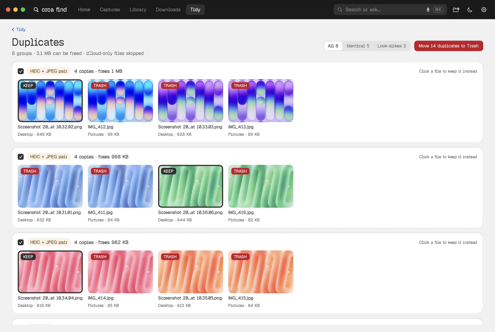 |
| **Downloads.** Grouped by where they came from. | **Duplicates.** Keep one, trash the rest. |

## Connect Claude

Orca's MCP server gives Claude read-only access to your captures, never your other files. It has three tools: `search_captures`, `get_capture` and `list_collections`.

- **Claude Desktop:** turn it on in **Settings › Captures**. Orca adds itself to Claude's config for you.
- **Claude Code:**

  ```sh
  claude mcp add orca -- "/Applications/Orca Find.app/Contents/MacOS/OrcaFind" --mcp
  ```

## Keyboard shortcuts

| Action | Keys |
|---|---|
| Quick Search from any app | ⇧⌘Space |
| Grab something on screen | ⌥⇧Space |
| Search, search by voice | ⌘F, ⌥⌘F |
| Home, Captures, Library | ⇧⌘H, ⌥⇧⌘C, ⇧⌘L |
| Downloaded from, Duplicates, Clean Up | ⇧⌘J, ⇧⌘D, ⇧⌘K |
| Copy text from images | ⇧⌘C |
| New smart folder, save search as smart folder | ⇧⌘N, ⌥⌘S |
| Inspector, Quick Look | ⌘I, Space |
| Grid, list, bigger and smaller cards | ⌘1, ⌘2, ⌘+, ⌘− |
| Light or dark | ⌃⌘T |
| Play or pause music | ⌘Space |

## URL scheme

Shortcuts and other apps can open Orca with these links:

`orcafind://search?q=pdfs%20from%20gmail`, `orcafind://quick-search`, `orcafind://voice`, `orcafind://duplicates`, `orcafind://clean-up`, `orcafind://downloaded-from`, `orcafind://latest-download`

## Requirements

| | |
|---|---|
| macOS | 14 Sonoma or later |
| Mac | Apple silicon for the release download. Intel Macs can build from source, without the voice model. |
| Sentence understanding | Apple Intelligence on macOS 26, where your Mac supports it |
| Permissions | Desktop, Documents and Downloads. Microphone for voice, Screen Recording for captures, Reminders when you say "remind me", and browser automation so each capture keeps its page link. |
| Storage | About 70 MB for the app, plus any private AI skills you unlock |

## Build from source

You only need the Command Line Tools, not Xcode.

```sh
git clone https://github.com/itsgrj/orca-find.git
cd orca-find
./build.sh release --open    # builds "build/Orca Find.app" and opens it
./build.sh debug             # faster compile while developing
```

The first build fetches the Core ML models into `Resources/Models` (about 430 MB, kept out of git). Converting the quick eraser needs Python 3 and installs PyTorch into a temporary environment. Builds are signed ad-hoc, so macOS may ask for folder access again after each rebuild.

Developer hooks:

```sh
.build/debug/OrcaFind --parse "pdfs from last week over 5 mb"                  # how a query is understood
.build/debug/OrcaFind --search --root ~/SomeFolder --ocr --dupes "invoices"   # end-to-end search
.build/debug/OrcaFind --snapshot ./shots --root ~/FakeHome                    # render screens to PNG
```

### Project layout

| Folder | What's inside |
|---|---|
| `Sources/OrcaFind/App` | App entry, state, preferences, debug CLI |
| `Sources/OrcaFind/Search` | Query parser, search engine, smart folders, sentence understanding |
| `Sources/OrcaFind/Index` | File scanner, SQLite index, text extraction, Vision and MobileCLIP |
| `Sources/OrcaFind/Captures` | Grabbing, recording, spoken intent, reminders, MCP server |
| `Sources/OrcaFind/Edit` | Photo, PDF, video and audio editing |
| `Sources/OrcaFind/Tidy` | Duplicates, Clean Up, automatic clean-up |
| `Sources/OrcaFind/Services` | Quick Look, hot keys, voice, private AI, music player |
| `Sources/OrcaFind/UI` | Every screen and the design system |
| `tools` | App icon and model fetch scripts |
| `website` | The Orca Find landing page |

## Known gaps

- **Shortcuts and Siri actions** are written as App Intents, but macOS only registers them when the app is built with Xcode. Until then, use the URL scheme.
- **Signing.** Releases are signed ad-hoc and not yet notarized.
- **Universal binary.** The build script makes a native build for the Mac it runs on.
- **Updates.** There's no auto-update yet. Watch this repo's releases.

## Contributing

Bug reports and ideas are welcome. See [CONTRIBUTING.md](CONTRIBUTING.md) and the [code of conduct](CODE_OF_CONDUCT.md).

## License

Copyright © 2026 Gokul. All rights reserved. The source is published so you can read it and build it for yourself. See [LICENSE](LICENSE) for the terms and for the licences of the third-party parts.

## Acknowledgements

- [FluidAudio](https://github.com/FluidInference/FluidAudio) by FluidInference, for running Parakeet on the Neural Engine (Apache 2.0)
- [NVIDIA Parakeet TDT 0.6B v2](https://huggingface.co/nvidia/parakeet-tdt-0.6b-v2), the English speech model (CC BY 4.0)
- [Apple MobileCLIP](https://github.com/apple/ml-mobileclip), for understanding photos (Apple Machine Learning Research Model License)
- [LaMa](https://github.com/advimman/lama) by Samsung AI, the Pro eraser (Apache 2.0), with the Core ML conversion by john-rocky
- [MI-GAN](https://github.com/Picsart-AI-Research/MI-GAN) by Picsart AI Research, the quick eraser (MIT)
- The [CLIP](https://github.com/openai/CLIP) tokenizer files by OpenAI (MIT)
- [Geist Pixel](https://vercel.com/font) by Vercel (SIL Open Font License)
